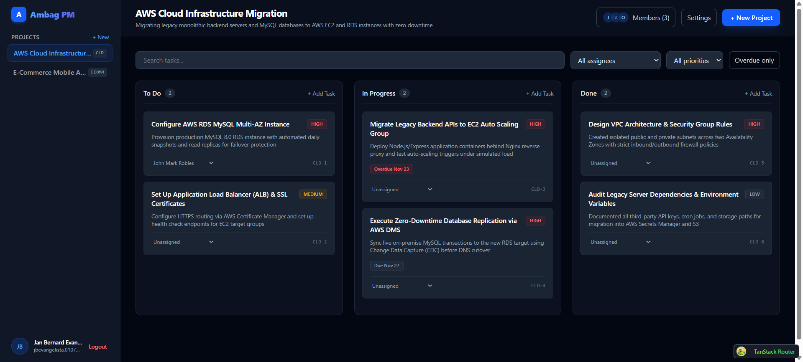

# Ambag PM

A real-time project board for teams. Create projects, invite people, and move tasks across a kanban board while everyone sees the changes live.



**Live demo:** https://ambagpm.vercel.app/ _(the free hosting tier sleeps when idle, so the first load can take about a minute)_

**Demo login:** https://ambagpm.vercel.app/login

## Features

- **Accounts:** register and log in with JWT authentication
- **Projects:** create projects with a short key (like `CLD`), edit them, and delete them (owner only)
- **Members:** the owner invites people by email, members can leave, and the owner can remove anyone
- **Kanban board:** To Do, In Progress and Done columns with drag and drop that is saved on the server
- **Tasks:** keys like `CLD-1`, priority, assignee, due dates with overdue badges, and a details modal to edit or delete
- **Comments:** threaded under each task, live for everyone who has the task open
- **Search and filters:** by text, assignee, priority, or overdue only
- **Real time:** moves, new tasks, assignments, comments, invites and removals show up without refreshing
- **Security:** hashed passwords, input validation, rate-limited login, security headers, and a server that refuses to start without a JWT secret
- **Tests:** 17 API integration tests against an in-memory MongoDB

## Tech stack

| Area    | Tools                                                                                                          |
| ------- | -------------------------------------------------------------------------------------------------------------- |
| Client  | React, TypeScript, Vite, Tailwind CSS, TanStack Router, Zustand, Axios, @hello-pangea/dnd, socket.io-client    |
| Server  | Node.js, Express, TypeScript, MongoDB with Mongoose, Socket.IO, JWT, bcryptjs, zod, helmet, express-rate-limit |
| Testing | Vitest, Supertest, mongodb-memory-server                                                                       |
| Hosting | MongoDB Atlas, Render (server), Vercel (client)                                                                |

## Getting started

### Requirements

- Node.js 20 or newer
- MongoDB running locally, or a MongoDB Atlas connection string

### 1. Clone

```bash
git clone https://github.com/MyNameIsJb/PROJECT-MANAGEMENT-PLATFORM.git
cd PROJECT-MANAGEMENT-PLATFORM
```

### 2. Server

```bash
cd server
npm install
cp .env.example .env
```

Open `server/.env` and fill in the values (see the table below). To generate a secret:

```bash
node -e "console.log(require('crypto').randomBytes(48).toString('hex'))"
```

Then start it:

```bash
npm run dev
```

The API runs at `http://localhost:8000`.

### 3. Client

In a second terminal:

```bash
cd client
npm install
cp .env.example .env
npm run dev
```

Open `http://localhost:3000`, register an account, and create your first project.

## Environment variables

**Server (`server/.env`)**

| Variable      | Description                                                      | Example                                                 |
| ------------- | ---------------------------------------------------------------- | ------------------------------------------------------- |
| `PORT`        | Port the API listens on                                          | `8000`                                                  |
| `NODE_ENV`    | `development` or `production`                                    | `development`                                           |
| `MONGODB_URI` | MongoDB connection string                                        | `mongodb://localhost:27017/project-management-platform` |
| `JWT_SECRET`  | Secret used to sign tokens. The server will not start without it | a long random string                                    |
| `CLIENT_URL`  | Allowed origin for CORS and sockets                              | `http://localhost:3000`                                 |

**Client (`client/.env`)**

| Variable          | Description                 | Example                     |
| ----------------- | --------------------------- | --------------------------- |
| `VITE_API_URL`    | Base URL of the REST API    | `http://localhost:8000/api` |
| `VITE_SOCKET_URL` | URL of the Socket.IO server | `http://localhost:8000`     |

Restart the client dev server after changing its `.env`, because Vite only reads it at startup.

## Scripts

| Where    | Command              | What it does                    |
| -------- | -------------------- | ------------------------------- |
| `server` | `npm run dev`        | Start the API with auto-reload  |
| `server` | `npm run build`      | Compile TypeScript to `dist`    |
| `server` | `npm start`          | Run the compiled server         |
| `server` | `npm test`           | Run the API tests once          |
| `server` | `npm run test:watch` | Re-run tests when files change  |
| `client` | `npm run dev`        | Start the Vite dev server       |
| `client` | `npm run build`      | Build the client for production |

The first `npm test` downloads a MongoDB binary, so it needs internet and takes a minute. After that it runs in a few seconds.

## How it works

- **The database is the source of truth.** The client sends changes through the REST API. After each save, the server broadcasts the fresh data to everyone viewing that project.
- **Clients never broadcast board events.** A fake or unsaved move can't reach anyone, because only the server sends them.
- **Sockets are authenticated.** A connection needs a valid JWT, and a user can only join the room of a project they belong to.
- **Two kinds of rooms.** `board:<projectId>` carries task and comment updates for people viewing a board. `user:<userId>` carries project-level events such as invites, renames, deletions and removals, so they arrive even when the user is looking at a different project.
- **Moves keep order clean.** The move endpoint inserts the task at its new index and renumbers the affected columns, and the client updates optimistically and rolls back if the server refuses.
- **Drag and drop pauses while a filter is active.** A card's index in a filtered column isn't its real position, so dropping it would save the wrong order.

### Permissions

| Action                              | Owner       | Member                  |
| ----------------------------------- | ----------- | ----------------------- |
| View project and tasks              | yes         | yes                     |
| Create, edit, move and assign tasks | yes         | yes                     |
| Comment                             | yes         | yes                     |
| Delete a task                       | any task    | only tasks they created |
| Delete a comment                    | any comment | only their own          |
| Invite members                      | yes         | no                      |
| Remove members                      | yes         | leave only              |
| Edit or delete the project          | yes         | no                      |

## API overview

All routes except register and login need a `Authorization: Bearer <token>` header.

| Method             | Route                                | Description                          |
| ------------------ | ------------------------------------ | ------------------------------------ |
| POST               | `/api/auth/register`                 | Create an account                    |
| POST               | `/api/auth/login`                    | Log in                               |
| GET, POST          | `/api/projects`                      | List your projects, create a project |
| GET, PATCH, DELETE | `/api/projects/:id`                  | Read, edit, delete a project         |
| POST               | `/api/projects/:id/members`          | Invite a member by email             |
| DELETE             | `/api/projects/:id/members/:userId`  | Remove a member, or leave            |
| GET, POST          | `/api/projects/:id/tasks`            | List tasks, create a task            |
| PATCH, DELETE      | `/api/tasks/:id`                     | Edit or delete a task                |
| PATCH              | `/api/tasks/:id/move`                | Move a task to a column and position |
| GET, POST          | `/api/tasks/:id/comments`            | List or add comments                 |
| DELETE             | `/api/tasks/:id/comments/:commentId` | Delete a comment                     |

**Socket events**

| Direction        | Event                                                  | Purpose                                             |
| ---------------- | ------------------------------------------------------ | --------------------------------------------------- |
| client to server | `join_board`, `leave_board`                            | Start or stop listening to a project's board        |
| server to client | `tasks_updated`                                        | The full task list for a project changed            |
| server to client | `comments_updated`                                     | The comments on a task changed                      |
| server to client | `project_updated`, `project_removed`, `member_removed` | Project-level changes that affect your project list |

## Project structure

```
.
├── client
│   └── src
│       ├── components    # dashboard (board, modals, filters) and layout (sidebar)
│       ├── pages         # route pages
│       ├── hooks         # useBoardSocket
│       ├── services      # API and socket clients
│       ├── store         # Zustand stores
│       ├── types
│       └── utils         # dates and task filtering
└── server
    └── src
        ├── config        # database and JWT helpers
        ├── controllers
        ├── middleware    # auth, validation, rate limits
        ├── models
        ├── routes
        ├── socket        # authenticated Socket.IO and room helpers
        ├── validators    # zod schemas
        └── __test__      # API integration tests
```

## Deployment

The app is set up for MongoDB Atlas (free cluster), Render (server) and Vercel (client).

1. Create an Atlas cluster, a database user, and allow network access, then copy the connection string into `MONGODB_URI`.
2. Create a Render web service from the `server` folder with the build command `npm install --include=dev && npm run build` and the start command `npm start`. Set `NODE_ENV`, `MONGODB_URI`, `JWT_SECRET` and `CLIENT_URL`.
3. Deploy the `client` folder on Vercel with `VITE_API_URL` and `VITE_SOCKET_URL` pointing at the Render URL, and a rewrite to `index.html` so routes like `/dashboard` survive a refresh.
4. Set `CLIENT_URL` on Render to the Vercel URL, with no trailing slash.

## Roadmap

- A contributions view showing who completed what, with `completedAt` and `completedBy` recorded when a task moves to Done
- Comment counts on cards
- An activity log per task
- Who is online on a board
- More tests for the socket layer and the client

## Author

Built by JB ([@MyNameIsJb](https://github.com/MyNameIsJb)).
